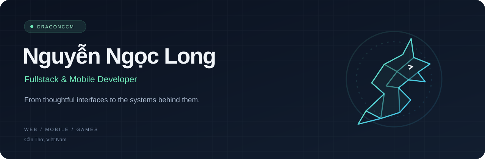

  

  
  
  

### Xin chào, mình là Long 👋

Kỹ sư **Kỹ thuật Phần mềm** tại Cần Thơ, Việt Nam. Mình xây dựng ứng dụng web, mobile và khám phá phát triển game — từ giao diện người dùng đến API và dữ liệu phía sau.

Mình thích **UI chỉn chu, code dễ bảo trì và kiến trúc serverless**. Những dự án ở đây là nơi mình biến ý tưởng thành sản phẩm, thử nghiệm công nghệ và tiếp tục học qua việc xây dựng.

---

### Selected work

<table>
<tr>
<td width="50%" valign="top">

#### 🎮 [GameHub · Zalo Minigame](https://github.com/dragonccm/zalo-minigame)

Cổng minigame với bảng xếp hạng, thành tựu và phòng chơi multiplayer. Có game cờ vua, Cubes 2048 và các game arcade.

`JavaScript` `WebSocket` `PostgreSQL`

</td>
<td width="50%" valign="top">

#### 🗂️ [Project Manager](https://github.com/dragonccm/Project_manager)

Dự án quản lý công việc trên nền web, xây dựng với Next.js và TypeScript.

`Next.js` `TypeScript` `React`

</td>
</tr>
<tr>
<td width="50%" valign="top">

#### 🎵 [WTFMusic](https://github.com/dragonccm/Wtf-music-Fontend)

Giao diện ứng dụng nghe nhạc với hệ sinh thái React, Redux và các thành phần phát audio.

`React` `Redux Toolkit` `Socket.IO`

</td>
<td width="50%" valign="top">

#### 🧁 [WtfCupcake](https://github.com/dragonccm/WtfCupcake)

Ứng dụng mạng xã hội trên mobile, sử dụng React Native, Expo Router và Firebase.

`React Native` `Expo` `Firebase`

</td>
</tr>
<tr>
<td width="50%" valign="top">

#### 🐉 [RPG 2D Topdown](https://github.com/dragonccm/RPG_2D_TOPDOWN)

Game nhập vai 2D với hệ thống kỹ năng, hiệu ứng chiến đấu và AI kẻ địch.

`Unity` `C#` `Addressables`

</td>
<td width="50%" valign="top">

#### ✦ [Portfolio](https://github.com/dragonccm/portforlio)

Không gian giới thiệu bản thân và các dự án mình xây dựng.

[Xem portfolio ↗](https://dragonccm-portforlio.vercel.app)

</td>
</tr>
</table>

### Toolbox

| Mảng | Công nghệ |
| :--- | :--- |
| **Frontend** | React · Next.js · TypeScript · Tailwind CSS |
| **Backend** | Node.js · Express · .NET Core · PHP · Python · Java |
| **Mobile** | React Native · Expo |
| **Data** | MongoDB · Firebase · MySQL · PostgreSQL · Redis |
| **Games** | Unity · C# |
| **Workflow** | Git · Docker · Postman · Figma |

<b>Mình quan tâm điều gì khi xây dựng sản phẩm?</b>

- **Trải nghiệm:** giao diện rõ ràng, tương tác mượt và hữu ích cho người dùng.
- **Cấu trúc:** chia module hợp lý để dự án dễ đọc, dễ sửa và dễ mở rộng.
- **Kết nối:** khám phá realtime, đồng bộ dữ liệu và tương tác nhiều người.
- **Thử nghiệm:** mang những gì học được từ web, mobile và game vào dự án tiếp theo.

---

  <b>Cùng trao đổi về sản phẩm, công nghệ hoặc một ý tưởng thú vị.</b>  
  <a href="mailto:nguyenngoclong5511@gmail.com">nguyenngoclong5511@gmail.com</a> · <a href="https://dragonccm-portforlio.vercel.app">Portfolio</a>

